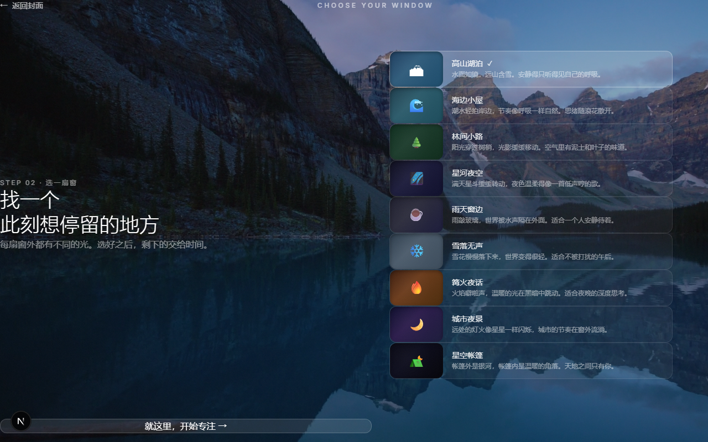
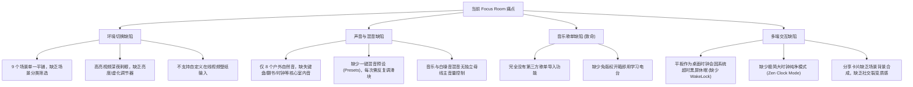
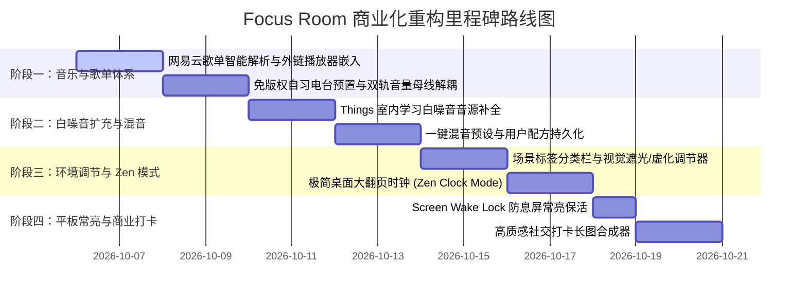

# Focus Room 商业化标杆自习室架构重构与演进方案

> **文档版本**：v2.0 (Commercial Architecture Specification)  
> **面向对象**：项目决策人、技术评审 Agent、工程实施团队  
> **核心目标**：将 Focus Room 从轻量 Web 页面升级为成熟商用、全端适配（电脑 / iPad 平板 / 手机）的标杆级在线虚拟自习室（Virtual Focus Space）。

---

## 目录
1. [项目愿景与商业化定位](#一项目愿景与商业化定位)
2. [实机现状与现有缺陷普查（附实机运行截图）](#二实机现状与现有缺陷普查)
3. [顶尖竞品架构深度逆向与可复用资产分析](#三顶尖竞品架构深度逆向与可复用资产分析)
4. [四大核心子系统设计方案](#四大核心子系统设计方案)
   - [4.1 国内主流音乐歌单导入与双模播放系统](#41-国内主流音乐歌单导入与双模播放系统)
   - [4.2 室内白噪音矩阵扩充与双音轨协同引擎](#42-室内白噪音矩阵扩充与双音轨协同引擎)
   - [4.3 环境视觉调节管线与极简 Zen Mode](#43-环境视觉调节管线与极简-zen-mode)
   - [4.4 平板/手机多端适配与商业化打卡裂变闭环](#44-平板手机多端适配与商业化打卡裂变闭环)
5. [分阶段实施路线图与技术指标](#五分阶段实施路线图与技术指标)
6. [提交给评审 Agent 的技术论证指引](#六提交给评审-agent-的技术论证指引)

---

## 一、 项目愿景与商业化定位

### 1.1 核心诉求
打造一个**可商用、高完成度、桌面桌搭级审美**的沉浸式在线虚拟自习室。用户在自习、工作、码字或冥想时：
1. **环境**：拥有丰富、安静、唯美的动态环境，可自由切换，且能按需调节画面明暗与光影，不刺眼；
2. **声音**：能同时叠加环境白噪音与自己喜爱的音乐，双轨分流，互不干扰；
3. **歌单**：支持一键导入**中国国内主流音乐软件（网易云音乐、QQ音乐等）**的歌单并直接流畅播放；
4. **终端**：支持 PC 电脑大屏、iPad/安卓平板（作为桌面陪伴时钟）、手机端流畅自适应。

### 1.2 商业化标杆定位
对标全球标杆产品 **LifeAt Spaces (lifeat.io)** 与 **Lofi.co**，结合国内学习者的真实刚需（网易云歌单习惯、考研/考公/期末备考、iPad 桌面时钟桌搭、小红书自习打卡分享），打造体验超越竞品的自习产品。

---

## 二、 实机现状与现有缺陷普查

### 2.1 当前项目实机运行状态
当前工程基于 **Next.js 16 (App Router) + React 19 + Tailwind CSS + Web Audio API**，已完成时间戳计时器防丢帧、离开 10 分钟防沉迷弹窗、`useSyncExternalStore` 响应式 i18n、以及视频预加载降级与 Poster 海报。

#### 实机落地页（Landing Page）


#### 实机专注自习界面（Focus View）


### 2.2 核心痛点与缺陷排查清单



---

## 三、 顶尖竞品架构深度逆向与可复用资产分析

为了避免“从零重新造轮子”，我们深入逆向了 GitHub 高星开源项目与商业标杆的核心代码与技术架构：

### 3.1 `remvze/moodist`（4,200+ Stars 开源环境音标杆）
- **核心机制**：
  - 音频引擎采用标准 Web Audio API，每个音轨分配独立 `GainNode` 控制通道增益，最终汇入主 `MasterGainNode`。
  - 音频矩阵化分类：`Nature`（自然）、`Rain`（雨水）、`Places`（场所）、`Things`（室内物件：机械键盘打字、翻书、钟表滴答）。
  - **混音预设序列化**：支持将多个音轨的音量配置编码保存至 LocalStorage 或以 URL Hash 形式一键分享。
- **可直接复用代码/资产**：
  - 直接吸纳其 **Things 室内学习白噪音清单与音频循环剪辑标准**；
  - 复用其 **AudioContext + GainNode 混音母线分流架构** 与 **混音预设数据结构**。

### 3.2 `zhheo/HeoMusic` & `MetingJS`（国内主流歌单解析与网页嵌入标杆）
- **核心机制**：
  - 针对国内音乐平台（网易云音乐、QQ音乐）版权壁垒，前端标准化解析歌单链接或 ID，请求开放 Meting 协议接口，获取标准曲目列表（歌名、歌手、封面、音频直链、LRC 歌词）。
  - 支持非 VIP 歌曲使用标准 HTML5 Audio 播放，VIP 歌曲提供优雅的外链回退保障。
- **可直接复用代码/资产**：
  - **国内歌单 ID 正则嗅探器**：一键识别网易云/QQ音乐分享文案并提取有效 ID；
  - **磨砂玻璃微型音乐播放条（Mini Player Bar）交互设计**。

### 3.3 `LifeAt Spaces` (lifeat.io - 全球百万级商业自习室 SaaS)
- **核心机制**：
  - **视觉滤镜管线（Atmosphere Dimmer & Blur）**：在背景视频层与 UI 层之间增加一层动态滤镜控制器，支持亮度（Brightness 20%~100%）、背景虚化（Blur 0~16px）、护眼滤镜（Warmth 0~40%）。
  - **iPad 平板防息屏锁（Screen Wake Lock API）**：`navigator.wakeLock.request('screen')` 保证设备自习时不灭屏。
  - **多源音频抽屉（Audio Drawer）**：侧边抽屉无缝整合「环境音白噪音」+「音乐流媒体」+「番茄计时器」。
- **可直接复用设计**：
  - 视觉环境调节器实现方案；
  - iPad 平板常亮桌面陪伴模式；
  - 场景标签页分类分类体系。

---

## 四、 四大核心子系统设计方案

### 4.1 国内主流音乐歌单导入与双模播放系统

国内音乐平台的版权策略和反盗链极其严格，单一方案往往无法兼顾“稳定性”与“高颜值”。因此采用**双模融合架构（Dual-Mode Hybrid Player）**：

```
                ┌──────────────────────────────────────────────┐
                │             用户粘贴歌单链接 / ID             │
                └──────────────────────┬───────────────────────┘
                                       │
                         智能正则识别与平台判断
                                       │
              ┌────────────────────────┴────────────────────────┐
              ▼                                                 ▼
    【模式 A：网易云官方外链播放器】                     【模式 B：自研玻璃拟态微型播放器】
   (100% 官方合规、曲目完整、防跨域403)              (Meting 协议 / 预置免版权自习电台)
              │                                                 │
  • 智能生成磨砂玻璃卡片浮窗                         • 提取封面/歌名/歌手，唱片旋转动效
  • 完整支持 VIP 歌曲试听与登录态                    • 与白噪音处于同一 Web Audio 引擎
  • 支持一键折叠为右下角黑胶唱片浮标                 • 支持上一曲/下一曲/歌词滚动/音量联动
```

#### 1. 模式 A：网易云歌单官方外链智能嵌入（最稳健方案）
- **交互逻辑**：
  - 用户点击顶部或音乐面板的「导入歌单」按钮，直接粘贴网易云音乐分享链接或文案；
  - 前端正则匹配自动提取 `playlist_id`：
    ```ts
    const match = input.match(/(?:id=|playlist\/)(\d+)/)
    const playlistId = match ? match[1] : input.trim()
    ```
  - 自动在右侧/浮动抽屉生成官方外链 iframe：
    ```html
    <iframe
      border="0"
      frameborder="no"
      marginwidth="0"
      marginheight="0"
      width="340"
      height="430"
      src="//music.163.com/outchain/player?type=0&id=${playlistId}&auto=1&height=430"
      className="rounded-2xl glass-strong shadow-2xl"
    />
    ```
  - **折叠态设计**：用户可点击右上角最小化，播放器收缩为右下角一个微型旋转黑胶唱片浮动按钮，不遮挡自习壁纸；点击唱片即可再度展开。

#### 2. 模式 B：自研玻璃拟态微型播放条（极客与沉浸感方案）
- **功能特色**：
  - 基于 Meting 规范解析公开歌单，直接在底部控制台嵌入原生的极简音乐播放控件；
  - 具备黑胶慢速旋转封面、走马灯歌名、播放/暂停、上一曲/下一曲、音量滑块；
  - 歌曲播放时，可直接与环境白噪音同频共振。

#### 3. 模式 C：开箱即用的免版权自习电台（零门槛体验）
- 无需用户费心寻找歌单，系统内置 3 套高赞专注音乐流：
  1. ☕ **Lo-Fi Study Beats**（节奏轻松、防疲劳的学习节拍）
  2. 🎹 **Ghibli & Peaceful Piano**（宫崎骏与久石让风格沉静钢琴曲）
  3. 🌧️ **Deep Focus Ambient**（深度专注脑波微音）

---

### 4.2 室内白噪音矩阵扩充与双音轨协同引擎

#### 1. 白噪音音色库扩充（吸纳 Moodist 精选）
自习室用户最核心的场景是“模拟图书馆/自习室内部声学”，因此在原有 8 个大自然音效基础上，扩充**室内自习专注音效**：

| 音效名称 | 标识符 | 场景效果 | 素材规格（Web 极速循环优化） |
| :--- | :--- | :--- | :--- |
| **机械键盘打字** | `keyboard` | 青轴/茶轴节奏清脆打字声，极具编程与码字氛围感 | 380 KB MP3, 无缝 Loop |
| **翻书沙沙声** | `book` | 图书馆翻阅纸质书籍的柔和声响 | 260 KB MP3, 无缝 Loop |
| **老时钟摆滴答** | `clock` | 规律轻柔的滴答走字声，增强时间流逝专注感 | 180 KB MP3, 无缝 Loop |
| **窗外细雨** | `rain-window`| 雨水敲击窗户玻璃的室内隔绝声 | 420 KB MP3, 无缝 Loop |
| **咖啡厅人声低语** | `cafe-murmur`| 远景柔和咖啡厅低语（不含清晰人声语言干扰） | 520 KB MP3, 无缝 Loop |

#### 2. 双音轨独立母线架构（Dual-Bus Engine）
在 [`contexts/AudioContext.tsx`](file:///c:/Users/暴龙战士wink/Desktop/agent/focus-room/contexts/AudioContext.tsx) 中重构音量控制拓扑：
- **母线 1：Music Bus（音乐母线）**：控制歌单/电台音量（0% ~ 100%）；
- **母线 2：Ambient Bus（白噪音母线）**：
  - 提供 **Ambient Master Volume（白噪音主音量）**；
  - 各个独立白噪音滑块作为分路增益（Channel Gain）；
  - **总控静音与恢复**：支持一键单独暂停白噪音或一键单独暂停背景音乐，也可全局一键静音。

#### 3. 一键氛围混音预设（Soundscape Presets）
内置经过专业声学比例测试的预设混音方案，点击即切：
- 🌧️ **「雷雨夜读」**：窗外细雨 60% + 翻书沙沙 40% + 咖啡馆低语 20%
- 💻 **「极客深夜编程」**：机械键盘 70% + 时钟滴答 25% + 窗外微雨 30%
- 🏕️ **「林间静思」**：森林微风 50% + 篝火噼啪 40% + 夜晚虫鸣 30%
- 💾 **用户自定义保存**：用户调好自己最喜欢的滑块比例后，可点击“保存为我的专属混音”，持久化至 LocalStorage。

---

### 4.3 环境视觉调节管线与极简 Zen Mode

高颜值的环境是自习室的核心卖点。当前只有视频播放，缺乏视觉层次感调节。

#### 1. 场景分类标签栏（Scene Categorization）
将当前平铺的场景升级为多维度分类：
- `🌿 治愈自然`：高山湖泊（Mountain Lake）、海边微风（Seaside）、静谧森林（Forest）、温暖篝火（Campfire）
- `☕ 空间声学`：雨夜咖啡（Rainy Cafe）、雪夜窗景（Snowy Window）、城市夜景（City Night）
- `🌌 浩瀚星空`：星空帐篷（Starry Tent）、璀璨星河（Starry Sky）
- `🎨 二次元 / Lo-Fi 空间`（新增插画风循环场景）

#### 2. 环境氛围调节器（Atmosphere Adjuster）
在自习室背景上叠加动态 CSS 滤镜管道：
```css
/* 视频背景滤镜层计算公式 */
filter: brightness(var(--bg-brightness)) blur(var(--bg-blur)) sepia(var(--bg-warmth));
```
- **遮光度（Dimmer）**：调节范围 0% ~ 80%（拉暗背景视频，夜间让番茄时钟与学习任务更清晰突出）；
- **背景虚化（Blur）**：调节范围 0px ~ 16px（让动态背景变为柔和梦幻的动态光影，彻底消除动态画面对视线的轻微干扰）；
- **护眼暖色（Eye-care Warmth）**：调节范围 0% ~ 40%（柔和暖黄光，缓解长时间自习眼部疲劳）。

#### 3. 极简桌面禅意时钟（Zen Flip-Clock Mode）
专门为 iPad / 平板摆在书桌上设计的“桌搭神器模式”：
- **触发方式**：点击顶部「纯净模式」按钮，或在画面任意空白处双击 / 按快捷键 `Z`；
- **视觉呈现**：界面所有操作栏、侧边栏、按钮全部平滑渐隐至 0 悬空消失；
- **中央呈现**：画面中央浮现大字号呼吸感数字时钟 / 翻页番茄钟；
- 移动鼠标或轻触屏幕任意位置，控制界面再度优雅淡入。

#### 4. 自定义在线壁纸/视频支持
用户可在设置中填入自己喜欢的任意 MP4 视频直链或在线动态壁纸 URL，保存后即刻成为当前自习室专属背景。

---

### 4.4 平板/手机多端适配与商业化打卡裂变闭环

#### 1. iPad / 平板核心痛点：屏幕防息屏常亮（Screen Wake Lock API）
自习室用户最反感的是 iPad 摆在桌面自习，过了 2 分钟屏幕自动黑屏锁屏。
- 引入现代 Web 标准 API：
  ```ts
  let wakeLock: WakeLockSentinel | null = null
  async function requestWakeLock() {
    if ('wakeLock' in navigator) {
      try {
        wakeLock = await navigator.wakeLock.request('screen')
      } catch (err) {
        console.warn('WakeLock not granted:', err)
      }
    }
  }
  ```
- 当番茄钟或正计时开始时，自动激活 Wake Lock，保持屏幕长亮；计时结束或用户切走应用时优雅释放，确保省电与体验两全。

#### 2. 商业化打卡分享海报升级（小红书 / 朋友圈裂变级）
升级现有 [`components/ShareCard.tsx`](file:///c:/Users/暴龙战士wink/Desktop/agent/focus-room/components/ShareCard.tsx)：
- 使用 HTML5 Canvas 将**当前自习场景高清壁纸 + 磨砂玻璃卡片 + 今日专注总时长 + 完成番茄数 + 自习日期 + 极简金句**合成渲染为一张 9:16 或 3:4 比例的高级打卡长图；
- 支持一键复制海报图片或下载至本地相册，具备天然的社交媒体自发分享裂变效应。

---

## 五、 分阶段实施路线图与技术指标

为确保工程落地稳健，代码无回归，建议分 4 个阶段递进实施：



### 交付物与质量指标
1. **代码质量**：全阶段保持 TypeScript 严格模式 0 错误、ESLint 0 错误；
2. **构建输出**：全阶段通过 Next.js Static Export 纯静态生产导出，无 Node.js 服务端运行时强依赖；
3. **性能基准**：Lighthouse Performance 得分保持在 90+，内存泄漏检测安全。

---

## 六、 提交给评审 Agent 的技术论证指引

若将本文档转交给另一位资深工程师 / Agent 进行技术评审，建议重点从以下几个维度发起评估：

1. **歌单导入可行性评估**：
   - 采用“网易云官方外链播放器（Mode A）为主 + 预置免版权自习电台（Mode C）兜底”的设计，是否能在**零后端成本、零跨域 403 风险**的前提下最快实现商业化交付？
2. **双音轨架构解耦**：
   - 在已封装的 `AudioContext` 基础上抽象 `Master Volume` 与 `Ambient Volume`，是否具备良好的向后兼容性？
3. **平板桌搭体验落地**：
   - `Screen Wake Lock API` 与 `Zen Flip Clock` 的组合是否精准击中了 iPad/平板用户的桌面伴侣时钟痛点？
4. **视觉滤镜性能开销**：
   - 在全屏 `<video>` 容器上应用 `filter: brightness() blur()` 滤镜，在移动端 GPU 上的复合渲染性能开销是否可控？（建议针对低端设备使用 CSS 伪元素半透明遮罩降级）。

---
*(本文档已同步固化保存在项目根目录 `FOCUS_ROOM_COMMERCIAL_PROPOSAL.md`，文档内所有关联图片均已在 `docs/images/` 归档)*
