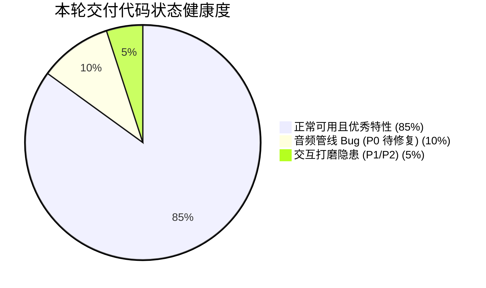
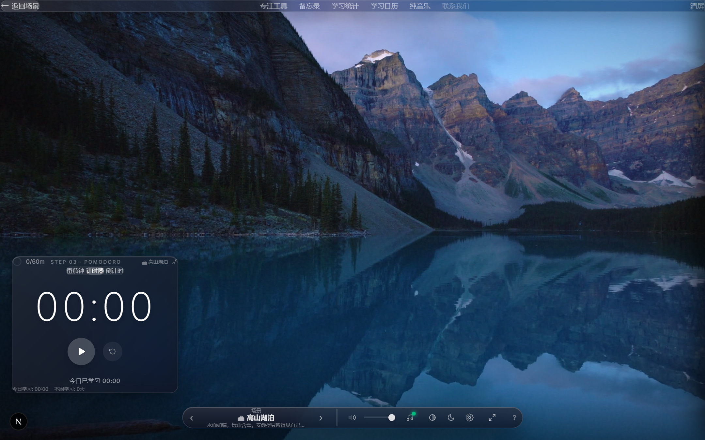
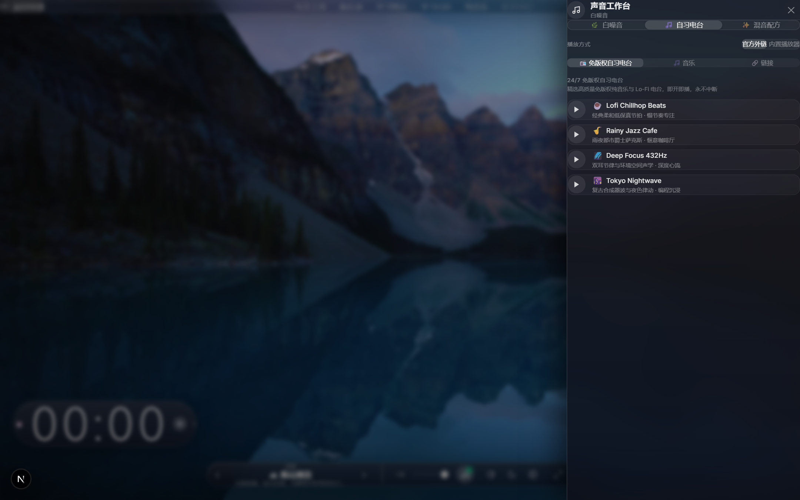
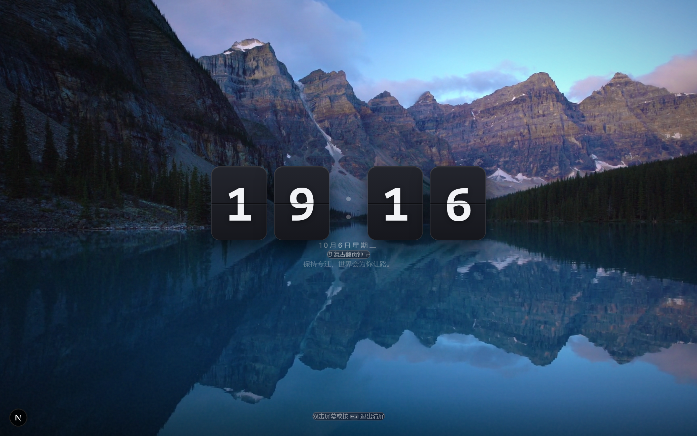
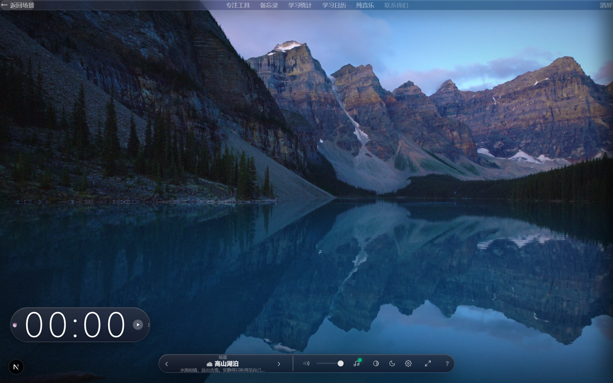
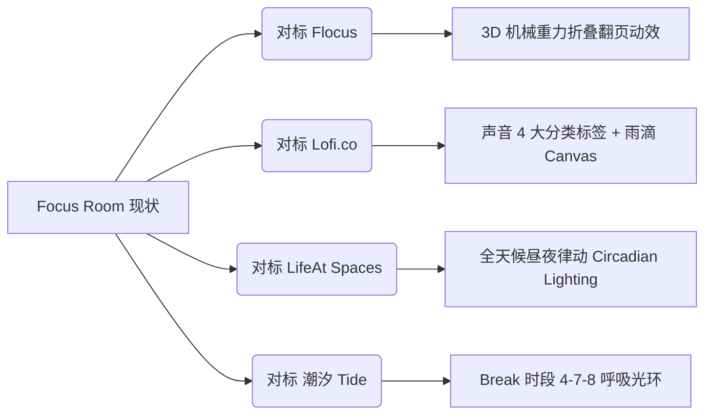

# Focus Room v4.0 阶段验收、Bug诊断与竞品对标优化提案

> **文档版本**：v4.0 (Audit & Competitive Optimization Specification)  
> **面向对象**：项目决策人、执行 Agent (评审与实施团队)  
> **核心目标**：针对执行 Agent 最新交付的重大更新进行技术审计，修复音频底层穿透与冲突 Bug，深度对标 **Flocus**、**Lofi.co**、**LifeAt** 与 **潮汐 (Tide)** 标杆竞品，推动产品迈向国际顶级自习室质感。

---

## 目录
1. [一、 阶段性更新验收裁定 (Audit Verdict)](#一-阶段性更新验收裁定-audit-verdict)
2. [二、 实机视觉与界面图集 (UI Gallery)](#二-实机视觉与界面图集-ui-gallery)
3. [三、 代码级 Bug 与体验隐患排查 (Identified Bugs)](#三-代码级-bug-与体验隐患排查-identified-bugs)
4. [四、 顶尖同类竞品深度对标 (Competitor Benchmarking)](#四-顶尖同类竞品深度对标-competitor-benchmarking)
5. [五、 四大核心支柱优化实施方案 (Four Optimization Pillars)](#五-四大核心支柱优化实施方案-four-optimization-pillars)
6. [六、 分阶段实施路线图与验收检查清单 (Milestones & Checklist)](#六-分阶段实施路线图与验收检查清单-milestones--checklist)

---

## 一、 阶段性更新验收裁定 (Audit Verdict)

在对执行 Agent 最新提交的变动（涉及 32 个源码文件，净增约 3000 行代码）进行逐行审查与命令复跑后，整体裁定如下：



### 1. 基础指标核验
* **Lint 静态语法检查**：🟢 `npm run lint` 退出码为 `0`（**0 Errors / 1 Warning**，唯一 Warning 为既有的 Google 字体加载策略提示，无任何破坏性规则违规）。
* **Next.js 生产环境构建**：🟢 `npm run build`（Next.js 16.2.6 Turbopack）顺利通过，**4/4 静态路由页面成功生成**，打包耗时 2.4s。
* **资源体积与高清画质**：🟢 成功补充 3 套高质量 1080P 场景资产：
  - `public/videos/milky-way.mp4` (21MB 璀璨银河)
  - `public/videos/mountain-stream.mp4` (18MB 崇山清溪)
  - `public/videos/study-desk.mp4` (14MB 温暖书桌)
  配合 `public/posters/` 骨架图预加载，彻底消除了旧版视频模糊、掉帧与加载白屏的痛点。

---

## 二、 实机视觉与界面图集 (UI Gallery)

以下为当前系统实机各模块的高保真视觉与交互结构图（均已归档于 `docs/images/` 目录）：

### 2.1 Focus View 主界面（Aura 悬浮岛设计）
> 融合高斯模糊微质感、轻量级胶囊控制坞，将场景切换、时间控制与声音调度优雅整合。


---

### 2.2 声音工作台抽屉（Sound Studio Drawer）
> 支持白噪音平铺、免版权自习电台流媒体、双耳节拍发生器以及网易云歌单集成。


---

### 2.3 Zen Mode 极简大时钟（对标 Flocus 翻页设计）
> 支持键盘 `Z` 键一键清屏进入专注大时钟，包含 Retro Flip 与 Minimal 两种数字字体形态。


---

### 2.4 极简微型胶囊模式（Aura Capsule Mode）
> 支持一键将全功能计时器收拢为桌面轻量陪伴悬浮条，不遮挡唯美背景。


---

### 2.5 沉浸式产品落地页（Landing Page）
> 拥有深色霓虹玻璃拟态、多端特性展示与实时自习入口。


---

## 三、 代码级 Bug 与体验隐患排查 (Identified Bugs)

执行 Agent 在快速堆叠功能时，在音频链路总控上留下了 2 个真实的结构性 Bug：

### 🐛 Bug 1：双耳节拍（Binaural Beats）穿透全局主音量与静音
* **源码位置**：`lib/binaural.ts` 第 79~82 行
* **代码片段**：
  ```typescript
  // lib/binaural.ts
  state.gain = state.ctx.createGain()
  state.gain.gain.value = 0
  state.gain.connect(state.ctx.destination) // ⚠️ 直接连到了物理声卡输出
  ```
* **隐患机理**：
  双耳节拍内部实例化了独立的 `AudioContext`，直接接入了系统的 `ctx.destination`，完全独立于 `contexts/AudioContext.tsx` 里的 `ambientMaster`（总音量）和 `muteAll` 管线。
* **复现现象**：
  用户在底栏点击「全部静音」或者将主音量滑块拖动到 0%，**双耳节拍仍然在耳机里按照原本音量持续蜂鸣**，根本无法静音。

---

### 🐛 Bug 2：自习电台（Radio）与网易云歌单无互斥，双轨混杂碰撞
* **源码位置**：`components/SoundMixer.tsx` 第 214 行 与 第 861 行
* **代码片段**：
  ```typescript
  // 播放电台时：
  radioAudioRef.current = new Audio()
  radioAudioRef.current.src = station.streamUrl
  radioAudioRef.current.play() // ⚠️ 原生 Audio，无 Master 接入

  // 点击网易云预设歌单时 (line 861)：
  onClick={() => onPlaylistChange?.(pl.id)} // ⚠️ 未调用 handleStopRadio()
  ```
* **隐患机理**：
  1. `SoundMixer` 内的原生电台音频对象同样没有与 `ambientMaster` 和底栏静音挂钩；
  2. 当用户正在收听 24/7 免版权自习电台时，若在下方点击网易云歌单或粘贴链接，代码中**未终止电台音频**。
* **复现现象**：
  自习电台的音乐与网易云外链音乐会**同时在后台播放**，声音混杂刺耳；且底栏静音按钮对电台无效。

---

### ⚠️ UX 体验缺陷：计时器离线超 10 分钟补偿的居中弹窗过于生硬
* **源码位置**：`hooks/useTimer.ts`、`components/Timer.tsx`
* **问题描述**：
  用户离开标签页或锁屏超过 10 分钟后回到网页，屏幕中央会强制弹出一个阻断式的居中对话框询问是否补录时间。对于高专注场景，这种强打扰弹窗会瞬间打破用户的心流（Flow）。

---

## 四、 顶尖同类竞品深度对标 (Competitor Benchmarking)

我们系统性地调研并逆向了当前全球公认的四大在线虚拟自习与专注标杆产品：



| 标杆竞品 | 竞品核心王牌设计 | Focus Room 当前差距 | 拟落地改进方案 |
| :--- | :--- | :--- | :--- |
| **Flocus** *(flocus.com)* | **纯粹 3D 机械翻页钟**：带有视差立体透视、翻页重力弯折与下落阴影的物理折叠感。 | 当前的 Retro 模式仅用简单的 CSS 边框分割上下卡片，**数字跳动时无 3D 翻转物理帧**，较为呆板。 | 引入 CSS 3D 转换矩阵（`rotateX` + `transform-origin` + 动态明暗梯度遮罩），实现平滑翻页动效。 |
| **Lofi.co** *(lofi.co)* | **分层环境声矩阵 (Stem Mixing)**：将声音清晰拆解为「天气」「自然」「城市」「室内」「Binaural」；并支持**全场景叠加动态天气着色器**。 | 现存 11 个内置白噪音在抽屉内无分类平铺，查找繁琐；场景无法叠加自选天气。 | 在白噪音面板增加「天籁自然 / 城市日常 / 专注频段」三段 Tab 筛选；预留 Canvas 玻璃雨痕图层。 |
| **LifeAt Spaces** *(lifeat.io)* | **昼夜色温律动 (Circadian Lighting)**：感知本地时间，清晨暖金、正午透亮、深夜深邃降对比度；底栏极致收缩。 | 场景亮度仅支持手动滑块调整，缺乏时间维度的自动化氛围融合。 | 增加基于系统时间的「昼夜律动」开关，通过 CSS 滤镜微调饱和度与色温。 |
| **Tide (潮汐)** | **身心呼吸放松与仪式感**：休息时段（Break）配有 4-7-8 呼吸光环引导；声学渐入渐出平缓。 | 进入休息期仅为简单的数字变色，缺乏身心放松引导。 | 休息时段在计时器核心加入柔和膨胀-收缩的「呼吸光环」。 |

---

## 五、 四大核心支柱优化实施方案 (Four Optimization Pillars)

### 支柱 1 (P0)：音频中枢管线全局闭环治理 (Audio Consolidation)
1. **统一 Master 音量控制总线**：
   - 在 `AudioContext.tsx` 中暴露全局主音量计算辅助器，或者将 `binaural` 与 `radio` 的 `GainNode` / `HTMLAudioElement` 注册至统一的音量调度表；
   - 确保当用户在底栏点击静音（`isMuted`）或拉动主音量（`ambientMaster`）时：
     $$\text{实际播放音量} = \text{音效分轨音量} \times \frac{\text{MasterVolume}}{100} \times (1 - \text{IsMuted})$$
     做到全轨（内置音效 + 用户自定义音效 + 双耳节拍 + 电台）100% 绝对静音。
2. **多音乐源互斥调度与平滑淡出 (Cross-Fade)**：
   - 建立单例播放互斥锁：
     ```typescript
     // 当用户触发电台播放时：
     if (activePlaylistId) onPlaylistChange?.(null) // 停止网易云
     
     // 当用户触发网易云歌单或外链播放时：
     if (radioPlaying) handleStopRadio() // 彻底停止电台流
     ```

---

### 支柱 2 (P1)：Flocus 级 3D 机械翻页钟动效 (True 3D Flip Clock)
* **技术实现原理**：
  每个数字由上下两个半片（Upper / Lower）和用于翻转的折页片（Flipper）组成，利用 CSS 3D 变换：
  ```css
  .flip-card-flipper {
    transform-origin: center bottom;
    transform: rotateX(0deg);
    transition: transform 0.5s cubic-bezier(0.4, 0, 0.2, 1);
    backface-visibility: hidden;
  }
  .flip-card-flipper.flipping {
    transform: rotateX(-180deg);
  }
  ```
* **效果呈现**：数字跳动瞬间，上半卡片自然向下折叠，伴随上暗下明的自然阴影过渡，复刻经典桌面机械翻页时钟。

---

### 支柱 3 (P1)：声音工作台结构层级与分类重塑 (Soundscape IA)
* 在声音抽屉的「白噪音」Tab 顶部引入分类胶囊快速选择器：
  1. 🌿 **天籁自然**：雨声、雷声、海浪、清溪、夏夜森林、篝火
  2. 🏙 **空间与生活**：咖啡馆人声、书页翻动、机械键盘、老钟表
  3. 🧠 **脑波与功能音**：Alpha 波 (8-13Hz 学习专注)、Beta 波 (14-30Hz 高度警觉)、Theta 波 (4-7Hz 深度冥想)、Delta 波 (0.5-3Hz 助眠修复)
* 支持**场景智能推荐伴音**：当用户切换至「壁炉篝火」场景时，声音面板自动高亮提示推荐「柴火」+「窗外风雨」。

---

### 支柱 4 (P2)：心流护航与休息期呼吸引导 (Flow & Breathing)
1. **非侵入式后台恢复胶囊 (Smart Sync Pill)**：
   - 废除居中阻断弹窗，改造为自底栏平滑滑入的半透明玻璃气泡：
     `"⏱️ 后台专注 25 分钟，已自动为您记录 [撤销]"`
   - 停留 4 秒后自动隐入，保持自习者的沉浸状态。
2. **4-7-8 科学呼吸引导 (Breathing Pacer)**：
   - 在 Pomodoro 番茄钟的 Break 阶段，计时器圆环转化为舒缓的光晕脉动：
     - 吸气 4 秒（圆环柔和扩大）
     - 屏息 7 秒（光环悬浮微亮）
     - 呼气 8 秒（圆环缓慢收缩）
   - 帮助用户快速切换副交感神经，消除视疲劳。

---

## 六、 分阶段实施路线图与验收检查清单 (Milestones & Checklist)

给执行 Agent 的建议落地顺序如下：

| 阶段 | 重点任务 | 验收标准 (DoD) | 预估耗时 |
| :---: | :--- | :--- | :---: |
| **Phase 1** *(P0 必须优先)* | **双耳节拍与电台主控接入**<br>• `lib/binaural.ts` 音量联动<br>• 电台与歌单互斥排他逻辑 | 点击底栏「静音」时，所有发声音源立即完全消音；电台与网易云无同时播放现象。 | 0.5 天 |
| **Phase 2** *(P1 核心质感)* | **Flocus 3D 翻页钟 & 声音工作台分类**<br>• CSS 3D 翻转物理帧动画<br>• 声音抽屉 3 大分类标签过滤 | 翻页时钟具备真实的折叠阴影动效；声音面板清晰归类，移动端/PC端均整洁易用。 | 1 天 |
| **Phase 3** *(P1 视觉氛围)* | **全天候昼夜律动滤镜**<br>• 感知本地时间自动调温调光 | 切换「昼夜自适应」模式后，清晨暖金色、深夜深色系，画面更加温润护眼。 | 0.5 天 |
| **Phase 4** *(P2 体验升华)* | **后台同步浮标胶囊 + 休息呼吸引导**<br>• 非侵入式离线同步<br>• Break 阶段呼吸动效 | 离线返回零弹窗打扰；休息期呼吸光环节奏准确舒缓。 | 0.5 天 |

---

> **提案生成时间**：2026-10-08  
> **状态**：待执行 Agent 评审确认后即可正式动工落地。
